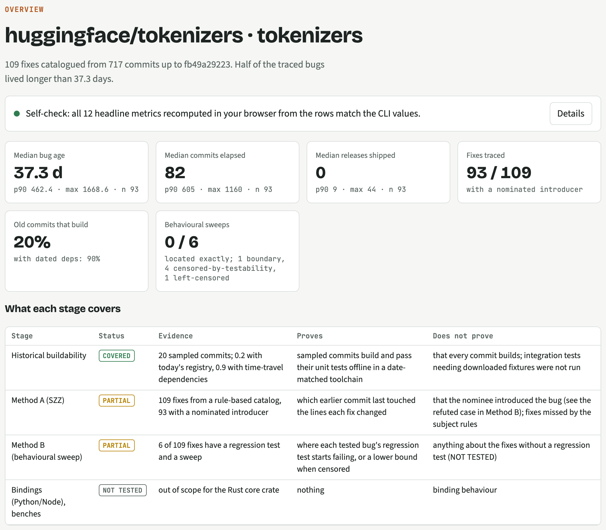

# bug-age

[](https://pypi.org/project/bug-age/) [](https://github.com/jacob-adm/bug-age/blob/main/pyproject.toml) [](https://github.com/jacob-adm/bug-age#license)

Measures how long fixed bugs lived in a git repository, using only its history. A bug counts only when the commit that fixed it says so in its message (*fix*, *bug*, *hotfix*); a bug fixed under any other message, or never fixed, is not counted. For each counted bug it reports commits elapsed, calendar days, releases shipped, and churn between the commit that introduced it and the fix.

It uses two independent methods and compares them:

- **Method A, blame-based (SZZ-style).** Runs `git blame` on the lines a fix changed and names the commit that last touched them as the likely introducer. This is fast and needs only git, but it can be wrong. Known failure cases: ghost commits, formatting-only changes, and introducers that were not the latest toucher.
- **Method B, behavioral sweep.** Takes a regression test that fails before the fix and passes after it, then replays that test across history in a hermetic per-commit Docker environment. The result is the first failing commit, the last passing commit, and every untestable commit with a reason.

Every number comes from scripts. AI helped write the code, the Method B regression tests and the article prose, but no model produces or changes a number. See [What is deterministic and what uses AI](https://github.com/jacob-adm/bug-age/blob/main/docs/method.md#what-is-deterministic-and-what-uses-ai). bug-age supports Rust crates and Python projects.

Each run writes a report: the result files in `results/<name>/` and one bundle, `dist/<name>/bundle.json`, which holds every number. `bug-age explorer` builds a static HTML page for browsing one or more bundles; it adds no results. The [example runs](https://github.com/jacob-adm/bug-age/blob/main/docs/example-runs.md) cover two Rust crates and two Python projects.

## Example output

The explorer's overview for the [tokenizers example run](https://github.com/jacob-adm/bug-age/blob/main/docs/example-runs.md): headline bug ages from Method A, the in-browser self-check, and what each stage covers and does not prove.

<p align="center"></p>

## Requirements

- Python 3.11 or later, standard library only.
- git.
- Docker, only for the feasibility check and Method B.
- Linux or macOS, both tested in CI.
- It measures Rust crates and Python projects.

## Install

From PyPI:

```
pip install bug-age
```

From a clone:

```
git clone https://github.com/jacob-adm/bug-age
cd bug-age
pip install .
```

Either way pip installs `bug-age` as a console script.

## How it works

1. **Find the fixes.** bug-age reads the commit history and lists every commit whose message says it fixes a bug (*fix*, *bug*, *hotfix*). A fix whose message doesn't say so is not counted.
2. **Find where each bug came from.** For each fix, git shows which earlier commit last wrote the lines the fix changed. That commit is the likely cause (Method A).
3. **Count how long it lived.** From that commit to the fix, bug-age counts the days, the commits and the releases that shipped with the bug.
4. **Check with a test, if you want.** Write a test that fails before the fix and passes after it. bug-age runs it at older commits, in Docker, to see where it starts failing (Method B).
5. **Write one report.** Everything goes into one file, `bundle.json`, with every name and email removed.

## Commands

```
bug-age catalog --repo DIR --path DIR [--profile rust|python (default rust)] [--head REV] [--out FILE]
bug-age szz --repo DIR --catalog FILE [--window-start YYYY-MM-DD] [--release-tags GLOB] [--out FILE]
bug-age sweep --repo DIR --path CRATE --fix SHA --overlay DIR --test CMD
      [--build CMD] [--start SHA] [--runner docker|local] [--repeats N] [--image IMG]
      [--time-travel-script FILE|none] [--scratch DIR] [--logs DIR] [--out FILE]
      [--namespace NAME] [--bucket N (toolchain minor rounding, default 4; 0 = exact)]
      [--step-timeout SECONDS (per fetch, build or test step; default 3600)]
      [--search bisection|exhaustive (exhaustive tests every commit; only it can report located)]
      [--profile rust|python] [--install SPEC (python, docker runner; default .)] [--test-deps A,B (python, docker runner; default pytest)]
bug-age probe --repo DIR --path CRATE --commits SHA,SHA,... --overlay DIR --test CMD [same options]
bug-age bundle --repo DIR --results DIR --repo-url URL --out DIR [--spike DIR] [--out-of-scope 'STAGE|EVIDENCE|DOES_NOT_PROVE']
bug-age explorer [--page FILE] --targets NAME=DIR,NAME=DIR --out DIR   (DIR = a bundle output dir)
bug-age mcp --bundles NAME=FILE,NAME=FILE   (read-only MCP server on stdio over bundle.json files)
bug-age pipeline TARGET.toml [--fresh] [--skip-feasibility]   (every stage for one target)
bug-age dockerfile   (print the Method B image's Dockerfile: bug-age dockerfile | docker build -t bug-age-spike:4 -)
```

Every command accepts only its own options; see [Commands](https://github.com/jacob-adm/bug-age/blob/main/docs/commands.md) for what each one does.

## Quick start

```sh
pip install bug-age
mkdir -p targets && curl -so targets/myrepo.toml https://raw.githubusercontent.com/jacob-adm/bug-age/main/targets/rust-sdk.toml
# edit targets/myrepo.toml: name, repo_url, head, crate_path (see Getting started)
bug-age pipeline targets/myrepo.toml --skip-feasibility   # Method A only, no Docker
```

The report is `results/myrepo/PIPELINE.md`, and every number is in `dist/myrepo/bundle.json`.
[Getting started](https://github.com/jacob-adm/bug-age/blob/main/docs/getting-started.md) walks through each step, Method B included.

## Documentation

- [Getting started](https://github.com/jacob-adm/bug-age/blob/main/docs/getting-started.md): install, describe your repository in a config file, run every stage, read the report and browse it.
- [Commands](https://github.com/jacob-adm/bug-age/blob/main/docs/commands.md): what each command does, the pipeline and its config file, and unattended sweeps.
- [Example runs](https://github.com/jacob-adm/bug-age/blob/main/docs/example-runs.md): the tokenizers, rust-sdk, requests and flask runs, what the explorer shows, and how to read Method B verdicts.
- [Method](https://github.com/jacob-adm/bug-age/blob/main/docs/method.md): how bugs are found, what is deterministic and what uses AI, and the rigor rules.
- [Timings](https://github.com/jacob-adm/bug-age/blob/main/docs/timings.md): how long each stage takes on the example runs.
- [Security](https://github.com/jacob-adm/bug-age/blob/main/SECURITY.md): what the local and Docker runners isolate and what they do not.
- [Versions](https://github.com/jacob-adm/bug-age/blob/main/docs/versions.md): 1.0.2, the last Rust version; 2.x, the Python package.
- [Contributing](https://github.com/jacob-adm/bug-age/blob/main/CONTRIBUTING.md): tests and how changes reach `main`.

## License

Licensed under either of [Apache License, Version 2.0](https://github.com/jacob-adm/bug-age/blob/main/LICENSE-APACHE) or [MIT License](https://github.com/jacob-adm/bug-age/blob/main/LICENSE-MIT), at your option, as declared in `pyproject.toml`.
