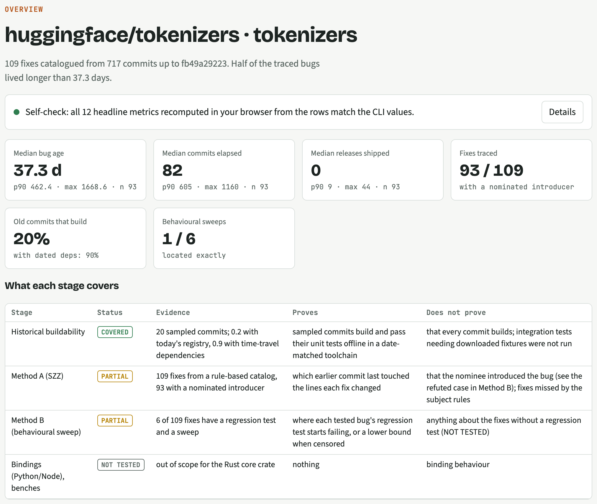
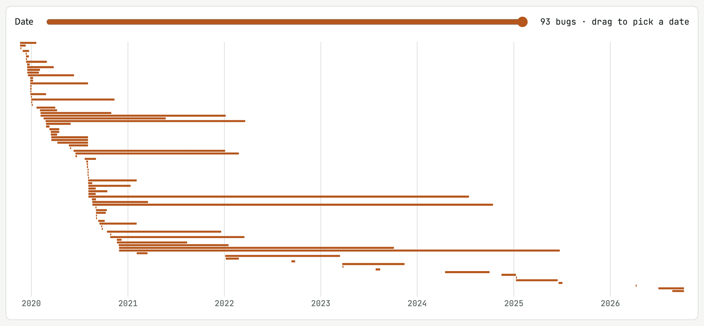
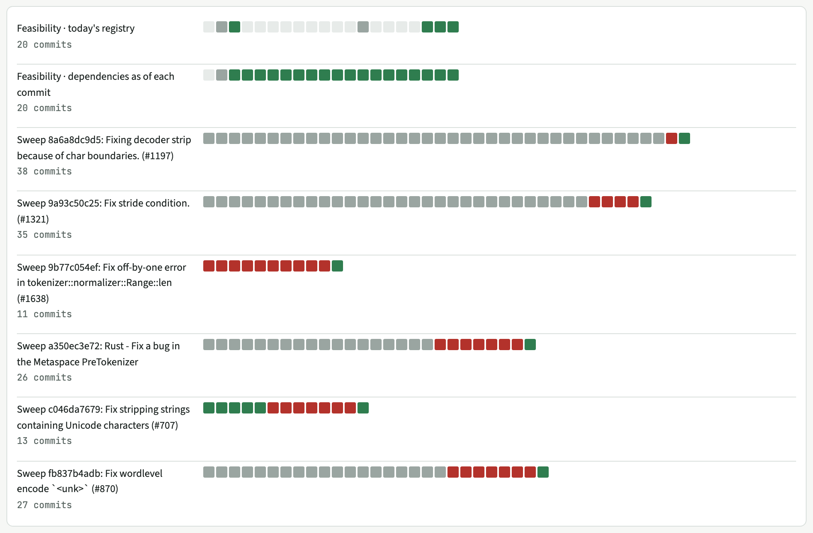

# bug-age

Measures how long bugs lived in a git repository, using real repository data. For each fixed bug it reports commits elapsed, calendar days, releases shipped, and churn between the commit that introduced it and the fix.

### ▶ [Open the live explorer](https://claude.ai/artifact/UDw6jyeA4zMDGhnzL7Typb)

Every bug, lifespan and test run from both showcase repositories (huggingface/tokenizers and modelcontextprotocol/rust-sdk). Each number opens to its evidence: the SHAs, the test runs, the receipt hash and the command that reproduces it. The page also recomputes its headline numbers in your browser and flags any mismatch.

[](https://claude.ai/artifact/UDw6jyeA4zMDGhnzL7Typb)

It uses two independent methods and compares them:

- **Method A, blame-based (SZZ-style).** Runs `git blame` on the lines a fix changed and names the commit that last touched them as the likely introducer. This is fast and needs only git, but it can be wrong. Known failure cases: ghost commits, formatting-only changes, and introducers that were not the latest toucher.
- **Method B, behavioral sweep.** Takes a regression test that fails before the fix and passes after it, then replays that test across history in a hermetic per-commit Docker environment. The result is the first failing commit, the last passing commit, and every untestable commit with a reason.

Every number comes from scripts. AI helped write the code, the Method B regression tests and the article prose, but no model produces or changes a number. See [What is deterministic and what uses AI](#what-is-deterministic-and-what-uses-ai).

Rust/Cargo is the first supported ecosystem. The first showcase target is the Rust core crate of [huggingface/tokenizers](https://github.com/huggingface/tokenizers); the second, run from a config file alone, is the `rmcp` crate of [modelcontextprotocol/rust-sdk](https://github.com/modelcontextprotocol/rust-sdk).

## What it produces

The pipeline writes a bundle (one JSON file, every number computed by a script) and a static explorer page built from it; the [live explorer](https://claude.ai/artifact/UDw6jyeA4zMDGhnzL7Typb) is that page for the two showcase targets. These screenshots are captured from that page by `make article`, so they always match the committed data.

**Overview.** Headline ages, how many old commits still build, and what each stage proves. The page recomputes these numbers from the raw rows in your browser and flags any mismatch.


**Lifespans.** Each bar runs from the nominated introducing commit to the fix. A date scrubber shows which bugs were alive on any day.



**Commit × test results.** Every commit the pipeline built and tested in Docker without network: green passes, red fails, grey does not build there. Each square opens the run log.



## What is deterministic and what uses AI

**Deterministic.** These parts make no model calls. Given the same repository, pinned commit and config, they produce the same output, and `make pipeline` needs no API key.

| Part | How it works |
|---|---|
| Fix catalog | Regular-expression rules over commit subjects, plus exclusion rules (docs, lint, release, ...). Locked by `classify_rules`. |
| Method A | `git blame` on the lines each fix changed; days, commits, releases and churn computed from git. |
| Buildability and Method B sweeps | Each commit built and tested in Docker with no network and a date-matched toolchain. PASS or FAIL comes from the test's exit status, and decisive commits are re-run. |
| Bundle and summary | Medians, 90th percentiles, counts and coverage computed by the CLI; the blameless gate rejects names and emails. |
| Explorer | Renders the bundle as it is, recomputes the headline numbers in the browser, and ranks search results with fixed rules. |
| MCP server | Returns values copied from the bundle; unknown input is an error, never a guess. |
| Article numbers | Inserted from the bundle by `scripts/article.py`, which fails on any number typed into the prose. |
| History scan | Fixed identity and email patterns over every committed file and message. |

**Uses AI.** In each case the AI's output is checked mechanically, and none of it becomes a number.

| Part | What AI did | What checks it |
|---|---|---|
| Method B regression tests (`results/<target>/repros/*/overlay`) | Drafted by an AI coding agent from each fix's diff | The sweep counts a test only if it fails before the fix and passes after it; otherwise the verdict is `repro-invalid`. Whether a test captures the real bug is a human judgement, so read the overlay. |
| Article prose (`article/ARTICLE.tmpl.md`) | Drafted with AI | Every number is a bundle reference; the check fails on anything else. |
| "Ask Claude" in the explorer (optional) | Claude answers a question on the viewer's own account, from the rows the search found | The answer is shown only if every cited SHA and every number appears in those rows. It runs only when the viewer clicks, and is hidden where unavailable. |
| The code | Written with an AI coding agent (Claude Code) and reviewed by the maintainer | Each change merged through a pull request after `cargo test`; commits carry a `Co-Authored-By` line. |

## Results so far (tokenizers)

The six repros and their per-bug comparison are in [`results/tokenizers/AB.md`](results/tokenizers/AB.md). Method A's output alone is in [`results/tokenizers/METHOD_A.md`](results/tokenizers/METHOD_A.md). The feasibility spike, which covers toolchain and dependency drift across history, is in `spike/results/`.

Verdicts are honest about what could not be tested:

| Verdict | Meaning |
|---|---|
| `located` | The exact first failing commit was found |
| `censored-by-testability` | The bug is present at the first commit where the test compiles, so its age is a lower bound (`≥`) |
| `left-censored` | The bug is already present at the start of the sweep range (3 years before the fix), so its age is a lower bound |

## Requirements

- Rust 1.86 or later
- Python 3 for the driver scripts
- Docker for Method B sweeps. Build the per-commit image from `spike/Dockerfile` and tag it `bug-age-spike:4`, the name the CLI uses by default; override it with `--image`.

## CLI

```
bug-age catalog --repo DIR --path CRATE [--head REV] [--out FILE]
bug-age szz     --repo DIR --catalog FILE [--window-start YYYY-MM-DD] [--out FILE]
bug-age sweep   --repo DIR --path CRATE --fix SHA --overlay DIR --test CMD
                [--build CMD] [--start SHA] [--runner docker|local] [--repeats N] [--image IMG]
                [--time-travel-script FILE|none] [--scratch DIR] [--logs DIR] [--out FILE]
                [--namespace NAME] [--bucket N]
bug-age probe   --repo DIR --path CRATE --commits SHA,SHA,... --overlay DIR --test CMD [same options]
bug-age bundle  --repo DIR --results DIR --repo-url URL --out DIR [--spike DIR]
bug-age explorer --page FILE --targets NAME=DIR,... --out DIR
bug-age mcp     --bundles NAME=FILE,...
```

| Command | What it does |
|---|---|
| `catalog` | Lists the fix commits that touch a crate and records why each other commit was excluded (docs, lint, release, and so on) |
| `szz` | Method A: names a likely introducing commit for each fix in the catalog |
| `sweep` | Method B: binary-searches for the first commit where the test compiles, then bisects PASS/FAIL above it. Decisive commits are re-run `--repeats` times and flagged UNSTABLE if the result changes |
| `probe` | Runs the same test at a fixed list of commits, with no search |
| `bundle` | Builds `bundle.json` (validated against [`schema/bundle.schema.json`](schema/bundle.schema.json)), `bundle.js`, and `receipt.json` (sha256 hashes and sizes) |
| `explorer` | Builds the static explorer page with one data file per repository; fails over 8 MB |
| `mcp` | Read-only MCP server on stdio answering bundle queries; see [`dist/agent/AGENTS.md`](dist/agent/AGENTS.md) |

## Running the pipeline

Each target repository has one config file in [`targets/`](targets/), and nothing else is target-specific:

```toml
name = "rust-sdk"
repo_url = "https://github.com/modelcontextprotocol/rust-sdk"
head = "5596a8a0bba2a1ec5519cc855cdadf23e4dcecdc"   # pinned subject
crate_path = "crates/rmcp"
work_dir = "work/rust-sdk"
results_dir = "results/rust-sdk"
spike_dir = "results/rust-sdk/spike"
dist_dir = "dist/rust-sdk"
samples = 20
# optional: szz_window_start = "YYYY-MM-DD", out_of_scope = "STAGE|EVIDENCE|DOES_NOT_PROVE"
```

One command runs every stage:

```sh
make pipeline TARGET=targets/rust-sdk.toml        # or: python3 scripts/pipeline.py targets/rust-sdk.toml
```

The stages are clone at the pinned head, feasibility (baseline and time-travel dependencies), catalog, Method A, Method B for every repro under `<results_dir>/repros/<fix>/overlay`, and bundle.

- A stage whose output already exists is REUSED, so the expensive Docker stages are never redone silently. Pass `--fresh` to rerun them.
- A failing stage is recorded with its reason, and the stages that don't depend on it still run.
- The run writes `<results_dir>/PIPELINE.md` and `pipeline.json`, listing each stage's status, reason, time taken and output sha256.
- A stage that did not run appears in the bundle's coverage as NOT TESTED.

Method B needs a regression test per bug, written as a test overlay. Those tests are drafted per target, so a target without any shows Method B as NOT TESTED.

### Unattended sweeps

```sh
make sweep ARGS="results/bench work/tokenizers tokenizers"
```

The sweep runs detached, with no agent involved. It writes `<results>/SUMMARY.md` and sends one macOS notification when it finishes. To check a run against committed results:

```sh
python3 results/compare_runs.py results/tokenizers results/bench   # prints IDENTICAL or the differences
```

## Rigor rules

- The subject is pinned: repo URL, SHA range, toolchain, and tool versions.
- Sweeps run with `--network none`, a date-matched toolchain, and dependencies resolved as they were at that date.
- A result is PASS only when its assertions actually ran. Anything else is reported as NOT TESTED.
- The bundle is blameless. It contains SHAs, dates, and short commit subjects only. Author names, emails, and usernames are redacted, and a gate fails the build if any remain.

## Tests

```sh
cargo test                 # unit and CLI tests
cargo test -- --ignored    # adds the end-to-end Docker runner test (needs the image)
```

## License

MIT OR Apache-2.0, as declared in `Cargo.toml`.
