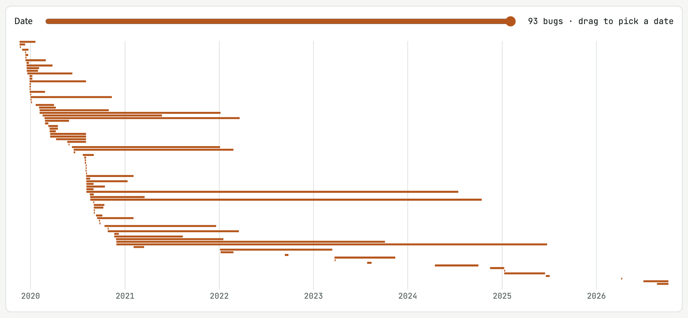
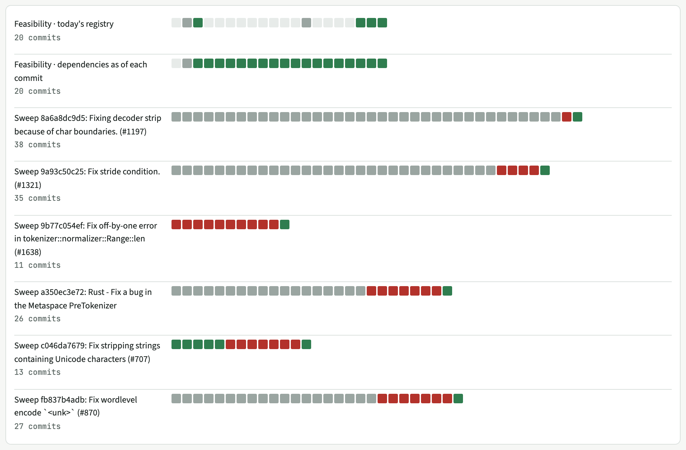

# How long do bugs live? I measured it in two Rust codebases

Half of the bugs I traced in Hugging Face's tokenizers crate had been in the code for more than {{tokenizers:summary.method_a.calendar_days.median}} days before someone fixed them. The oldest had been there for {{tokenizers:summary.method_a.calendar_days.max}} days and shipped in {{tokenizers:method_a[@max=days].lifetime.releases_spanned|len}} releases.

Those numbers come from a tool, not from me. I built bug-age to answer one question for any git repository: when a bug gets fixed, how long had it been there? Every figure in this post is read from a JSON bundle that the tool generates. A script checks this text against that bundle and fails the build if a number does not match.

## Why bug age matters

Most QA metrics count bugs. Few ask how long each one survived. Age tells you something counts cannot: whether your tests, reviews and releases catch problems in days or let them ride for years. A bug that lives through many releases is a bug your whole process missed, many times over.

## How it works

bug-age uses two methods and compares them.

**Method A (blame, often called SZZ).** For each fix commit, look at the lines it changed and ask git who last touched them. That commit is the nominated introducer. It is cheap and covers every fix, but it names the last person to edit a line, not necessarily the commit that broke it.

**Method B (behavioural sweep).** Write a regression test that fails before the fix and passes after it. Then run that test on older commits in Docker, with no network, until it stops failing. The first failing commit is where the bug began. This is expensive but exact, when old commits still build.

Before trusting either method, I checked whether history can be built at all. With today's crates.io registry, only {{tokenizers:summary.feasibility.baseline_share|pct}} of sampled tokenizers commits built and passed their unit tests. When each commit got dependencies as they were published on its own date, that rose to {{tokenizers:summary.feasibility.time_travel_share|pct}}. For tokenizers, dependency drift, not the code itself, is what breaks old builds.

## What I found

**tokenizers (Rust core crate).** The catalog scanned {{tokenizers:catalog.scanned}} commits and admitted {{tokenizers:summary.method_a.fixes}} fixes. Blame nominated an introducer for {{tokenizers:summary.method_a.with_introducer}} of them.

- Median age: {{tokenizers:summary.method_a.calendar_days.median}} days and {{tokenizers:summary.method_a.commits_elapsed.median}} commits.
- The slowest tenth (`p90`): {{tokenizers:summary.method_a.calendar_days.p90}} days or more.
- Longest-lived: "{{tokenizers:method_a[@max=days].fix|subject}}" at {{tokenizers:method_a[@max=days].days}} days, across {{tokenizers:method_a[@max=days].lifetime.commits_elapsed}} commits.



**Where blame and behaviour disagree.** I wrote regression tests for {{tokenizers:summary.method_b.swept}} tokenizers bugs and swept each one. One sweep found the exact first failing commit: "{{tokenizers:method_b[verdict=located].fix|subject}}". Blame said that bug was {{tokenizers:method_b[verdict=located].method_a_days}} days old. The sweep says {{tokenizers:method_b[verdict=located].days}} days. Running the test at blame's nominee showed it passed there, so the nominee did not introduce the bug.

For {{tokenizers:summary.method_b.verdicts.censored-by-testability}} other bugs, the test already failed at the oldest commit where it could compile, so their ages are lower bounds. One bug, "{{tokenizers:method_b[verdict=left-censored].fix|subject}}", was already present at the start of the swept range: at least {{tokenizers:method_b[verdict=left-censored].days}} days old.



**rust-sdk (the rmcp crate).** I ran the same pipeline on the Model Context Protocol Rust SDK with only a config file. The catalog admitted {{rust-sdk:summary.method_a.fixes}} fixes from {{rust-sdk:catalog.scanned}} commits, and blame traced {{rust-sdk:summary.method_a.with_introducer}}. Median age: {{rust-sdk:summary.method_a.calendar_days.median}} days; `p90`: {{rust-sdk:summary.method_a.calendar_days.p90}} days. The median bug shipped in {{rust-sdk:summary.method_a.releases_shipped_bug.median}} releases before its fix, and the worst in {{rust-sdk:summary.method_a.releases_shipped_bug.max}}. A fast release cadence means a bug that survives a few months ships many times. This is a young codebase: here, {{rust-sdk:summary.feasibility.baseline_share|pct}} of sampled commits built with today's registry.

## Patterns, locked in tests

Each rule the tool depends on is pinned by a deterministic test in the repository, so a regression in the method shows up as a failing test, not a quietly wrong number:

- Which commits count as fixes, and why the rest were excluded: `classify_rules`.
- Blame nominating the commit that planted a bug: `szz_nominates_planting_commit_with_scripted_lifetime`.
- A sweep finding the exact introducing commit: `locates_exact_introducing_commit`.
- Ages reported as lower bounds when old commits cannot compile the test: `censored_by_testability_when_bug_predates_compilable_test`.
- Rejecting a regression test that does not fail before the fix: `rejects_a_repro_that_does_not_fail_before_the_fix`.
- Stages that did not run reported as NOT TESTED instead of zero: `missing_stages_bundle_as_not_tested`.

## Limitations

Every stage reports what it proves and what it does not. For tokenizers:

{{tokenizers:coverage|limits}}

For rust-sdk:

{{rust-sdk:coverage|limits}}

One more caveat. Method A is a nomination, not proof: the one bug both methods could compare exactly shows blame can be off by a wide margin. Release counts depend on each repository's tag naming, which the target config sets.

## Run it on your repository

bug-age is a single Rust binary plus a pipeline script. Point a config file at a repository and a pinned commit, then run one command:

```sh
make pipeline TARGET=targets/your-repo.toml
```

It writes the bundle, a receipt with its `sha256` hash, a per-stage report, and a static explorer page. A read-only MCP server lets any agent answer questions from the bundle, citing SHAs.

## Explore the data

Every number above opens to its evidence in the explorer: the SHAs, the test runs, the receipt hash and the command that reproduces it. The page also recomputes the headline numbers in your browser and flags any mismatch.

[Open the bug-age explorer](https://claude.ai/artifact/UDw6jyeA4zMDGhnzL7Typb)
