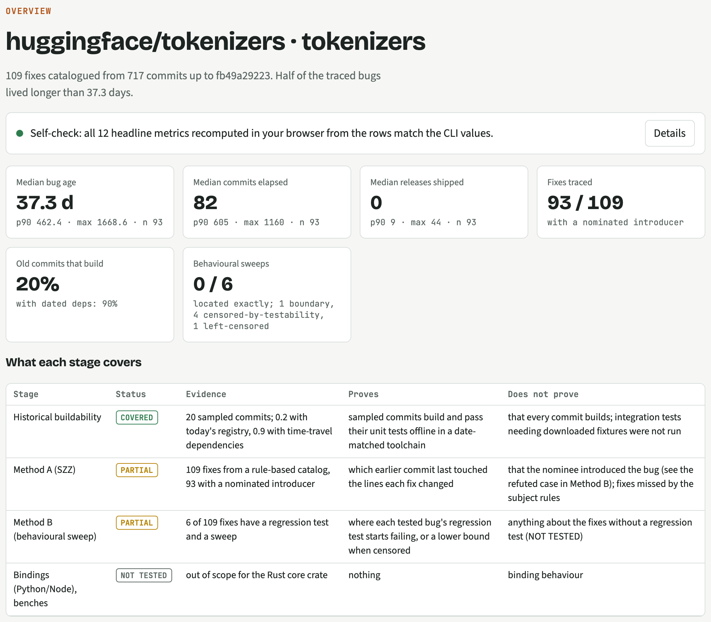
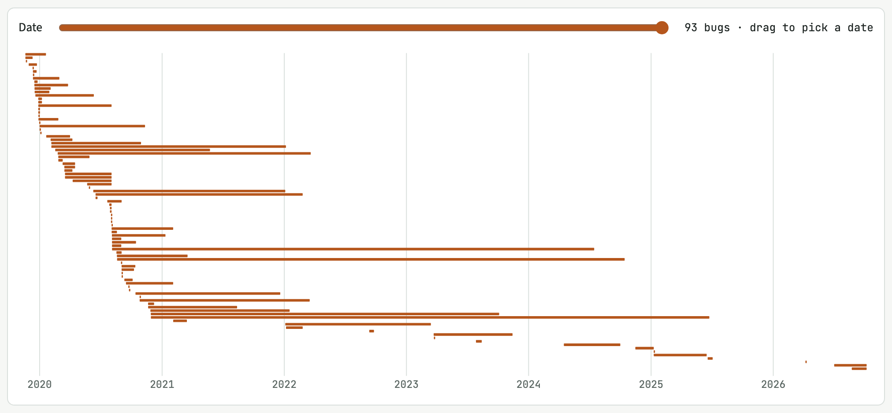
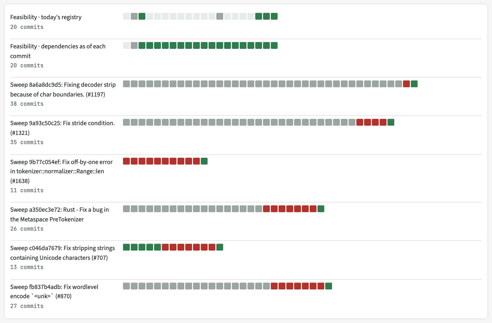

# Example runs

The four example runs: what they contain, how to browse them, and how to read their Method B verdicts.

## Example runs: tokenizers and rust-sdk

The same pipeline was run on two Rust codebases. The first, the core crate of [huggingface/tokenizers](https://github.com/huggingface/tokenizers), got every stage, including Method B sweeps for six bugs. The second, the `rmcp` crate of [modelcontextprotocol/rust-sdk](https://github.com/modelcontextprotocol/rust-sdk), was added with a config file alone, to show the pipeline carries over unchanged.

To browse all four runs, build the explorer from a clone with `make explorer` and open `dist/explorer/index.html`. Switch between the four repositories at the top. Each number opens to its evidence: the SHAs, the test runs, the receipt hash and the command that reproduces it. The page also recomputes its headline numbers in your browser and flags any mismatch.

| | tokenizers | rust-sdk |
|---|---|---|
| Config | [`targets/tokenizers.toml`](../targets/tokenizers.toml) | [`targets/rust-sdk.toml`](../targets/rust-sdk.toml) |
| Method A (every catalogued fix) | [`results/tokenizers/METHOD_A.md`](../results/tokenizers/METHOD_A.md) | [`results/rust-sdk/szz.json`](../results/rust-sdk/szz.json) |
| Method B (behavioural sweeps) | Six bugs: [`results/tokenizers/AB.md`](../results/tokenizers/AB.md) | NOT TESTED: no regression tests written yet |
| Stage report | [`results/tokenizers/PIPELINE.md`](../results/tokenizers/PIPELINE.md) | [`results/rust-sdk/PIPELINE.md`](../results/rust-sdk/PIPELINE.md) |
| Report of record (bundle) | [`dist/tokenizers/bundle.json`](../dist/tokenizers/bundle.json) | [`dist/rust-sdk/bundle.json`](../dist/rust-sdk/bundle.json) |

### What the explorer shows

These screenshots are captured by `make article` from the explorer built from the committed bundles, so they always match them.

**Lifespans.** Each bar runs from the nominated introducing commit to the fix. A date scrubber shows which bugs were alive on any day.

**Commit × test results.** Every commit the pipeline built and tested in Docker without network: green passes, red fails, grey does not build there. Each square opens the run log.

### Reading Method B verdicts

Verdicts are honest about what could not be tested:

| Verdict | Meaning |
|---|---|
| `located` | Exact. Only from `--search exhaustive`: every commit in the range was tested, every commit before the first failure passed, and the commit just before it passed |
| `boundary` | Lower bound (`≥`). The test passes at one commit and fails at the next, but an earlier failure is not ruled out: bisection tested only a sample, or an exhaustive search met untestable or flaky commits before the failure |
| `interval` | The bug started within a run of untestable commits between the last PASS and the first FAIL. Exact to that run only when the search was exhaustive and every earlier commit passed |
| `censored-by-testability` | The bug is present at the first commit where the test could be run (or, exhaustively, no earlier commit passed), so its age is a lower bound (`≥`) |
| `left-censored` | The bug is already present at the start of the sweep range (3 years before the fix), so its age is a lower bound |

A bisected sweep (the default) assumes that once the test builds it keeps building and that once it fails it keeps failing; `--search exhaustive` assumes neither and tests every commit.

The feasibility check, which measures toolchain and dependency drift across history, is in `spike/results/` for tokenizers and `results/rust-sdk/spike/` for rust-sdk.

## Example runs: requests and flask (python profile)

The python profile was run on [psf/requests](https://github.com/psf/requests) and [pallets/flask](https://github.com/pallets/flask), with config files alone: [`targets/requests.toml`](../targets/requests.toml) and [`targets/flask.toml`](../targets/flask.toml). Reports: [`results/requests/PIPELINE.md`](../results/requests/PIPELINE.md), [`results/flask/PIPELINE.md`](../results/flask/PIPELINE.md); bundles in `dist/requests/` and `dist/flask/`.

| | requests | flask |
|---|---|---|
| Feasibility, today's PyPI | 1 of 20 sampled commits built and tested | 1 of 20 |
| Feasibility, PyPI as of each commit | 3 of 20 | 2 of 20 |
| Method A | 169 fixes, 88 with a nominated introducer | 185 fixes, 90 with a nominated introducer |
| Method B | 3 sweeps, all `censored-by-testability` | 2 sweeps, both `left-censored` |

Both runs are NO-GO on feasibility, and the reports say why, commit by commit:

- **Commits before 2019 are not tested.** uv installs CPython 3.8 or later only, and those commits' build requirements fail to install there. Most of each history falls in this range.
- **Old test suites fail on later dependencies.** Even as of the commit date, some flask commits from 2020 to 2023 install and import but fail tests; they are recorded `TESTS_FAILED`, not dropped.
- **A fix that needs an unreleased dependency cannot be tested.** One flask regression test was left out because its fix commit needed a Werkzeug version not yet on PyPI, so the test failed at the fix as well.

Method B verdicts here are lower bounds: each bug is already present at the first commit where its test could run.
